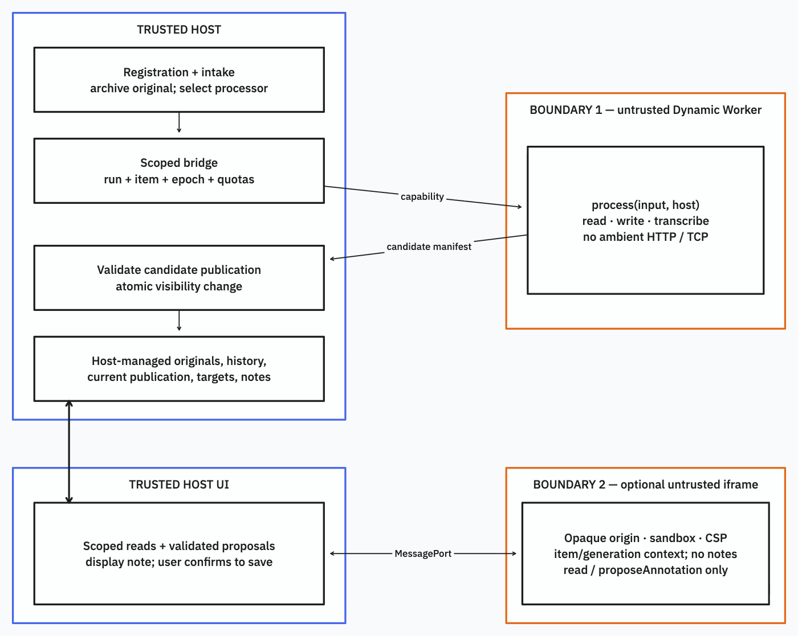
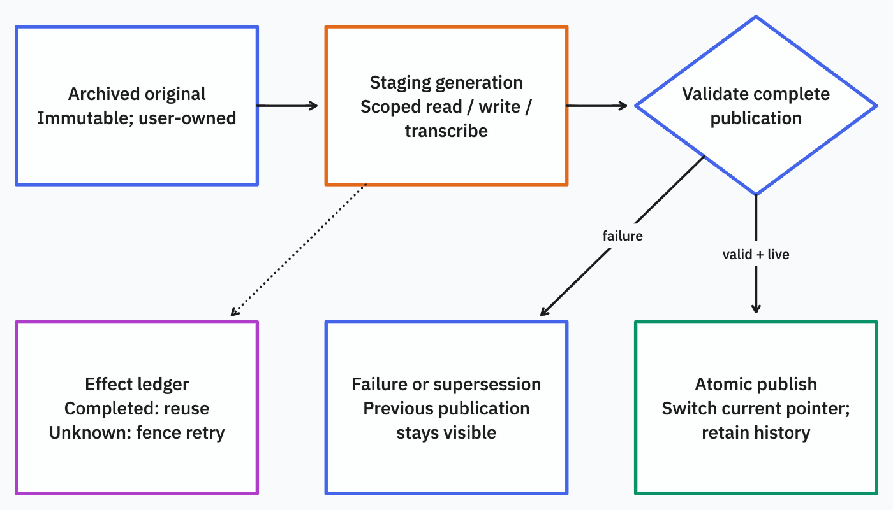
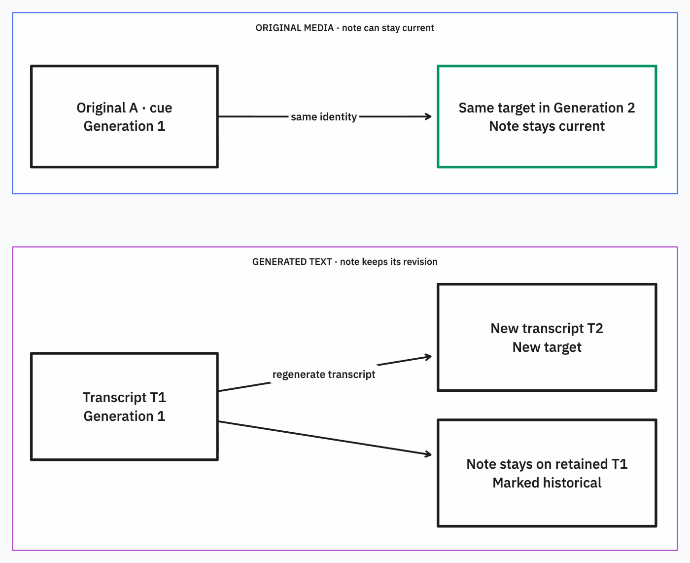

# Magpie: a small, tested extension contract

This repository investigates an extension boundary; it is not a production plugin platform or a migration of `stacks`. The proposal is one processing hook, host-scoped artifact/service capabilities, a validated publication, and an optional isolated detail component. User-owned originals and annotations outlive replaceable processing results.

The exact TypeScript signatures are in [src/contract.ts](src/contract.ts). The executable examples and the limitations below are part of the proposal, not incidental implementation details.

## The boundaries and why each exists



The processor and the detail component are separate untrusted programs. The host supplies each one's authority and validates what comes back. A processor returns a publication candidate; only the host can make it visible. The browser component can propose a note; only a user-confirmed host action can save it. [Editable diagram and sources](docs/diagrams/README.md).

| Surface | Exact contract | Requirement that earns it |
| --- | --- | --- |
| Host registration | `ProcessorRegistration` | A host can list processors accepting an input MIME type and require an explicit choice if several match. No first-installed-wins convention. |
| Plugin hook | `Processor.process(input: Input, host: ProcessingHost): Promise<Publication>` | Specialized extraction and composition of several derivatives; one function is enough for the experiments. |
| Artifact capabilities | `read(artifact, range?)` returns a byte stream; `write(meta, body)` returns an immutable artifact descriptor | Archived media, several video derivatives, selective Parquet reads, and immutable evidence for annotations. Storage keys and raw bucket bindings never cross the boundary. |
| Service capability | `transcribe(original, profile)` returns bounded structured segments | The video slice needs processing outside the isolate and an independent effect ledger. This is a concrete, grant-checked service, not a general HTTP proxy or arbitrary service registry. The two profiles are synthetic provider configurations. |
| Publication data | `Publication` | One validated visibility change ties list metadata, artifact references, explicit search strings/targets, and presentation together. Bytes are stored through capabilities, not returned inline. |
| Targets and notes | `TargetDraft`, host-issued `Target`, user-owned `Annotation` | Search results and notes need resolvable identities. A target binds an immutable artifact to a selector; a note is not processor output. |
| Optional detail component | `presentation.component` plus `ViewRequest` | Plugin-local playback interaction without granting access to host DOM, user sessions, or annotation mutation. `read` and `proposeAnnotation` are the only viewer requests. |
| Host fallback | `presentation.fallback: ArtifactId` with `text/plain` | Readability and selected search content survive plugin removal; list-card fields remain host declarations (a card-list UI is not implemented here). |

Registration is a host decision. Recognition here is declarative MIME matching (including a MIME-family wildcard), followed by explicit selection when ambiguous. No executable `recognize` hook was necessary. URL-specific recognition rules are not implemented. The host accepts URL/capture/upload/document provenance, but these experiments ingest local fixture bytes; they do not implement a network capture service or MCP server.

Recognition, processing and rendering do not have to execute in the same trust domain. The host recognizes/selects; a Dynamic Worker processes; an opaque-origin browser iframe renders a retained artifact. A renderer can be packaged independently and reused by a processor, but this prototype does not implement an installed-renderer registry or arbitrary multi-processor composition. Each publication belongs to one selected processor. Adding independent enrichment would need explicit input grants and a conflict/visibility policy; there is no general event bus.

## What changed the design

- The existing application already separates stable user items from captures, but refresh deletes the old capture and its original before the replacement succeeds. We retain originals and prior published generations, and switch visibility only after a complete publication is validated.
- Multiple artifact rows already exist outside `ContentHandler`; reserved `original`/`readable` names, HTML/PDF unions, image rewriting, item-level FTS and the reader constrain extensibility. Merely widening the handler return type cannot support a searchable transcript with a resolvable media target.
- There is no current annotation implementation to preserve. The new contract must identify targets explicitly and retain their artifact revisions; it must not silently reinterpret a note against new transcript text.
- EmDash's sandbox frontend is a host-rendered block vocabulary; its arbitrary native components are trusted build imports. Cloudflare OS implements arbitrary iframe code with a scoped RPC channel. Those are different frontend trust models, separate from backend Worker isolation.
- EmDash's broad content permission is not automatic per-item authority, and a wall timeout does not cancel a paid effect. The experiment checks artifact membership on each capability call and records effect outcomes independently of publication.
- Actual workerd exposes `process` even without our passing Node compatibility flags. What matters is that host environment variables and credentials are absent, rather than that a particular global is absent.

The [save trace](evidence/stacks-trace.md) cites the exact code/schema at Stacks commit `ba2c100d4cca0164cd1752cebaec72b11ba4a016`. [Prior-art evidence](evidence/prior-art.md) uses PR270 as a source map and verifies material mechanisms at immutable EmDash and Cloudflare OS commits. It distinguishes implemented code, documented promises, and proposals. No production data or production credentials were used.

## Ownership, identity and lifecycle



The visibility switch is the commit point. Writing a derived artifact does not publish it, and completing a transcription does not publish the generation. On an item's first attempt, there is no previous publication to show.

| Data | Identity and ownership | Mutation and retention |
| --- | --- | --- |
| Item | Host-issued item ID, owned by the user | Host controls provenance and current-generation pointer. A plugin cannot choose another item identity. |
| Original | Host-issued artifact ID, content hash, item membership, `generation: null` | Host archives bytes before processing. Plugins can read the granted original but cannot overwrite or delete it. |
| Derived artifact | Host-issued artifact ID, byte hash, item ID and generation ID | Plugin supplies new bytes within quotas. Existing bytes never change; publication selects which staged artifacts are visible. |
| Generation | Host-issued run ID, processor ID/version, host-recorded bundled-source digest, installation epoch | Staging results are not searchable. Success publishes a complete manifest; failed or superseded runs cannot publish late. |
| Target | Host-issued identity derived from item, artifact, local key and selector | Original-media targets can remain stable. A regenerated text artifact yields a different target; old target records remain resolvable. |
| Annotation | Host-issued note ID, item/target IDs, author and body | Created through a user-authorized host action. Processing code cannot alter notes. The host derives `current`/`historical` status. |

Originals are user data. Generated artifacts are regenerable, but once notes or search targets refer to a revision its meaning must remain available. This prototype conservatively retains every published generation and every original. It implements no garbage collector. A production retention policy must distinguish unreferenced staging debris from referenced historical evidence.

Publication validates item/run membership, the artifact manifest, presentation references, selector shape, text quote/range agreement, unique local keys, and every search reference. Time selectors receive structural and video-MIME checks; the host does not decode media duration. Fragment locators similarly require a compatible viewer to validate domain meaning. The valid controlled-fixture paths are tested; arbitrary media/geometry resolution is not. Search scans only the current publication's explicitly selected entries; this demonstrates visibility and resolution semantics, not a production FTS implementation. Reading an original before processing succeeds is intentional; staged derivatives remain unavailable to the reader.

Failure leaves the previous publication visible. Retry creates another generation, but a completed transcription result is reused using a host-derived identity containing item, plugin, original content hash and provider profile. A pending/unknown effect is fenced for reconciliation rather than automatically sent again. No exactly-once billing claim follows from this: an actual provider needs an idempotency key or a way to reconcile acceptance after a lost response.



Target identity includes **item + artifact + local key + selector**. The stable case requires all four to stay the same and the target to appear in the new publication. Equal bytes in a newly issued artifact do not make it the same target. The host derives note status from the current publication; it does not move the note.

Plugin upgrade/reinstallation revokes older live capabilities through a changed installation epoch; it does not silently migrate annotations. Removal rejects subsequent processing operations and future component loads while retaining originals, published data, fallback text, selected search entries, targets and notes. It does not terminate an already-loaded iframe or revoke bytes already transferred. This demo requires a reload to close that browser session; immediate live frontend revocation remains unimplemented.

## Enforcement and execution limits

The actual child Worker gets only a host-selected capability. Loader `globalOutbound: null` blocks ambient HTTP and TCP. The trusted wrapper overwrites run scope before forwarding requests; the store checks a live generation, installation epoch, artifact membership, ranges, service grant and quotas. TypeScript and a manifest alone do none of this. The plugin receives no storage path, raw store/loader binding, user session, provider credential or annotation writer.

The [browser interaction diagram](evidence/browser.md#how-a-proposal-becomes-a-note) follows a request across the second boundary, including the user confirmation step. The browser boundary is independent: `sandbox="allow-scripts"`, opaque origin, restrictive parent/child CSP, authenticated frame identity before MessagePort transfer, and host validation of every artifact/target. The component gets item/generation context, not the user's notes. It can propose a note; a trusted host click commits the displayed proposal. All raw artifact responses also carry a restrictive CSP sandbox, so opening an artifact directly does not grant host-origin script authority. The loopback server's action header is a test guard, **not production authentication**. There is no claim of a complete browser security audit.

Small JS extraction, streamed I/O and orchestration fit the demonstrated Worker boundary. Browser capture, native ffmpeg/CAD tooling, native DuckDB and durable long-running paid work require host services or separately tested Wasm alternatives. Local workerd does not establish production CPU/memory/billing behavior. The [runtime investigation](evidence/runtime.md) records pinned APIs and documented limits, including 128 MiB isolate memory, CPU limits and RPC streaming. Large-file throughput, cancellation of already-delivered bytes, external provider idempotency and production transactions remain untested.

The backing store is a single-process filesystem experiment with immutable content-hash blobs and atomic metadata snapshots. It is not D1/R2, a multi-writer database, a durable workflow engine, or a production server. Index publication and artifact membership are real local behavior, while expensive processing is controlled.

## Reproduction and evidence

Use Node 24 and the committed lockfile:

```sh
npm ci
npm run typecheck
npm test
npm run test:runtime
npm run test:browser
npm run demo
```

The demo serves the persisted synthetic video on `http://127.0.0.1:4173`. Playwright starts the same server. Browser/runtime tests need permission to open local listeners and launch Chromium. The browser config uses `PLAYWRIGHT_CHROMIUM_EXECUTABLE` if provided, otherwise an available macOS Playwright cache; install a compatible Chromium if none is available. There is no deployment or production credential requirement.

- [Preimplementation uncertainties and falsifiers](evidence/experiments.md): exactly three questions, covering backend authority, lifecycle/effects, and browser interaction.
- [Runtime probe and observations](runtime/README.md): an independent adversarial child module; actual Dynamic Worker/RPC enforcement; a positive inherited-egress canary and zero canary requests from the isolated child. [Machine-readable result](runtime/observed.json).
- Video input is a format-valid, synthetically generated WebM. Transcripts and thumbnail are synthetic controlled outputs, not a claim of speech recognition or visual understanding. The player itself is a real browser media element.
- Parquet input is a tiny, deterministic, format-valid synthetic file, reproduced by `fixtures/make-parquet.mjs`. It includes a secret column to test deliberate search exclusion. Its parser is real; it is not DuckDB.
- Current Stacks inputs/output shapes were inspected from checked-in synthetic fixtures/tests and the real schema. Those upstream tests were not executed here, and no local production database or recorded user capture was found.

Observed on 17 October 2026:

| Check | Observed result |
| --- | --- |
| TypeScript, host + plugin Workers + runtime probe | All three configurations passed. |
| Vitest semantic/integration/challenge suite | **11 tests passed** in the final combined run. Tests include publication failure, retry/effect uncertainty, foreign access, superseded runs, stable/historical notes, removal, failed metadata rename and revocation during a streamed write. |
| Real Dynamic Worker end-to-end | Both video and Parquet processed, published, searched and persisted through the actual loader and scoped bridge. Reopening the store retained the note. [Persisted-output observations](evidence/semantic-observed.json). |
| Independent adversarial Worker probe | Passed scoped stream/range access, host-secret exclusion, foreign access, HTTP/TCP denial and revocation; inherited-egress control succeeded and isolated egress count was zero. |
| Playwright / Chromium 153.0.8010.12 | **3 tests passed**: seek/playback plus host-confirmed annotation and Parquet fallback; browser authority attacks; tested fetch/navigation denial. [Browser evidence](evidence/browser.md). |

Parquet initially disproved an overly weak test: its parser used a range API but fetched the entire 351-byte file because of a default 512 KiB footer prefetch. The corrected processor explicitly reads the footer, then metadata, then selected data pages. Observed half-open ranges are **343–351**, **137–343**, and **4–70**; the secret column's page **70–137** is never read. Tests assert both no whole-file read and no intersection with that page. Deliberate indexing excludes the secret even though the original remains archived. The secret marker tests indexing selection, not a column access-control policy: this processor is granted the entire original and could request other byte ranges. This is selective I/O on one tiny fixture, not a large-file benchmark.

The browser experiment also falsified an incomplete CSP assumption: the parent needed an explicit blob-media allowance in addition to the child's policy. Actual seeking and playback passed after that correction. A purpose-built host video widget remains a valid alternative.

CAD was challenged **after** video/Parquet passed. Publication rejected a face/UV target as an unknown selector, showing that whole/text/time was insufficient. One amendment was earned:

```ts
{ kind: "fragment"; scheme: string; value: string }
```

The host requires a bounded versioned URN namespace and a bounded inert locator string. It neither dereferences the URN nor interprets geometry. Identity uses fixed selector-field tuples so object property ordering cannot invalidate a note. Two final challenge tests preserve the locator and note through reprocessing, upgrade, removal and restart, while a changed face becomes a new target. The input deliberately contains no valid CAD geometry: these results prove persistence/identity only. [Initial falsification, amendment and limits](evidence/cad-challenge.md).

No uncertainty was silently converted into a production guarantee. The backend capability boundary and tiny-fixture publication behavior are demonstrated locally; frontend behavior is demonstrated for the tested browser and interaction. Full domain runtimes and large-scale availability remain outside these results.

## Scenario fit and the simpler alternative

| Scenario | Mapping to the contract | Observed coverage and awkward fit |
| --- | --- | --- |
| Video | Original media; transcript JSON, readable text, thumbnail and component artifacts; selected transcript search entries point to original-media time targets; text targets retain exact old phrases. | Main slice runs end to end, including real playback and a saved note. The transcript and thumbnail are fixtures. Real archival acquisition, visual descriptions and synchronized thumbnail strips are not implemented. The browser buffers the whole tiny media file; large-media delivery needs an expressly tested range/stream strategy. |
| Parquet | Original file; byte-range reads; plugin-selected columns/materialized summary; search entries point to exact summary text. No transcription or extra host operation is granted. | Second slice proves format parsing, selective I/O, selective indexing, generic fallback and annotations without changing the host contract. It is hyparquet, **not DuckDB**. Full interactive SQL may require a query service, or a separately tested Wasm/worker allowance; the current browser policy does not grant those. A note on a regenerated summary is historical, not automatically attached to a new query row. |
| CAD | Original model, conversion/metadata artifacts if needed, custom viewer, and versioned fragment locator on a specified immutable artifact. | Held-out challenge earned the fragment case. No CAD engine, WebGL viewer, conversion, or valid face resolution was built. The viewer must validate face/point syntax and geometry. New topology needs an explicit mapping or new target; preserving the old locator is not rebasing it successfully. |
| Recipes | Captured original/source; recipe JSON plus readable text artifacts; selected ingredient/instruction search; annotations for substitutions or personal notes. | Not implemented. Freeform adaptations belong to user-owned annotations and survive regeneration. A fully structured editable personal recipe fork needs a host-owned authored document/version model; it must not be hidden inside regenerable plugin output. The contract does not supply such an editor. |
| Agent-authored documents | Host intake with document provenance and immutable original; ordinary processing/publication/search; the same host annotation operations. | Not implemented. MCP create/search belongs at the authenticated host API, not inside an untrusted processing hook. No MCP server, agent authorization flow or document editing/version API is claimed. |

These mappings explain where additional **services or product features** would be needed; they do not quietly add extension hooks. Distribution, marketplaces, production migration and complete implementations of the five examples remain outside scope.

The strongest simpler alternative is a sandboxed processor that emits a typed manifest and host-rendered templates/widgets, with no arbitrary browser component. It is sufficient for readable recipes/documents and can absolutely support synchronized video if the host implements that widget. The custom component experiment does not disprove this alternative. The reason to retain an optional component boundary is the stated product goal of user-created domain interaction without recurring host UI changes. Reconsider it if a small stable host widget vocabulary handles the actual video, table and CAD interactions, or if the iframe's media/worker/Wasm constraints make maintaining the component boundary more costly than maintaining those widgets.

No result here earns an event bus, an arbitrary metadata database, an install marketplace, a general command registry, or an automatic anchor-rebasing algorithm.
