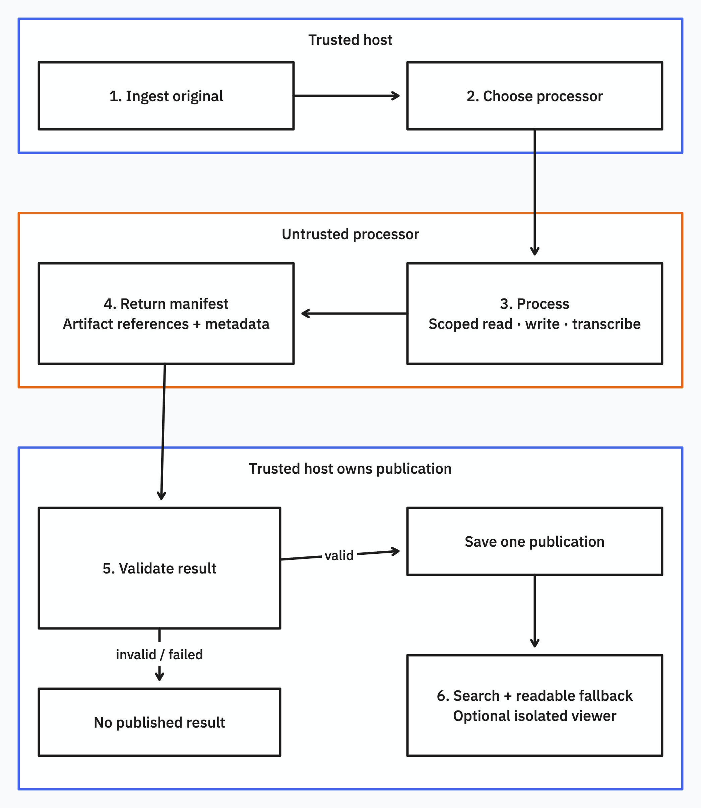

# Magpie: the core extension flow

One processing hook turns an archived original into a searchable result. The host owns storage and publication; an optional isolated component supplies the detail view. This experiment focuses on **ingest → process → publish → view**, using video and Parquet as concrete examples.

## The flow



1. **Ingest.** The host archives the original and assigns its item and artifact IDs.
2. **Select.** Match a processor's declared MIME types. If several match, require an explicit choice.
3. **Process.** Call `process(input, host)` in a Dynamic Worker. The processor reads bytes, writes derivatives, and may call an explicitly granted host service.
4. **Publish.** The processor returns metadata and artifact references. The host validates them and saves one complete result. Incomplete output is neither readable nor searchable.
5. **View.** The host displays readable text. A custom component can read the item's published artifacts through a broker to add domain-specific interaction.

There is one published result per item. Reprocessing, saved drafts, and annotations are outside this version. The host uses a temporary execution scope while processing; it is not a saved document or an editable result. Search entries identify an item and artifact, with no durable location/selector model.

## Two separate trust boundaries


| Surface | Responsibility |
| --- | --- |
| `ProcessorRegistration` | Declares accepted MIME types and service grants. Selection stays in the host. |
| `Processor.process(input, host)` | The single executable backend hook. Returns a `Publication`. |
| `ProcessingHost.read / write` | Streams bytes within the assigned item and execution scope, with range and quota checks. No bucket or storage path crosses the boundary. |
| `ProcessingHost.transcribe` | A concrete service capability for the video example. Provider authority stays in the host; the current response is synthetic. |
| `Publication` | Title, description, derivative references, selected search text with artifact references, and presentation references. A `text/plain` fallback is required; thumbnail and component are optional. |
| Viewer `read` | The component's only host operation. The broker checks artifact membership before returning bytes. |

The [exact TypeScript contract](src/contract.ts) is small enough to read in full. [Editable tldraw canvases and Mermaid sources](docs/diagrams/README.md) accompany both diagrams.

The Worker receives only a scoped `HOST` binding. `globalOutbound: null` denies ambient HTTP/TCP. The trusted bridge supplies execution scope; the store checks scope, ownership, grants, ranges, and quotas. Returning a manifest does not let plugin code publish directly.

The browser boundary is independent: an opaque-origin iframe with `sandbox="allow-scripts"`, restrictive CSP, and a MessagePort transferred only to the expected frame. The component cannot access host DOM or make host mutations. Raw artifact responses also carry a restrictive CSP sandbox. [Browser implementation and evidence](evidence/browser.md).

## Two examples, the same contract

| Example | Processing | Presentation |
| --- | --- | --- |
| Video | A format-valid synthetic WebM produces transcript JSON, readable text, a thumbnail, and component HTML. Selected transcript text is searchable. Transcription and thumbnail content are controlled fixtures. | Actual browser playback and transcript-cue seeking. The component reads transcript JSON and interprets timestamps itself; the host knows nothing about cues. |
| Parquet | A real parser reads selected byte ranges and materializes only `label` and `value`. The secret column is absent from the summary and search. | The same host displays the readable summary without a custom component. No new host capability is needed. |

Parquet's default footer prefetch initially read the whole tiny file despite using a range API. The processor now explicitly reads **343–351** (footer), **144–343** (metadata), and **4–70** (selected pages). Tests reject a whole-file read or any intersection with the excluded page **70–144**. This demonstrates selective I/O, not column-level authorization: the processor is granted the original and could request other ranges.

## Run it

Use Node 24 and the committed lockfile:

```sh
npm ci
npm run typecheck
npm test
npm run test:runtime
npm run test:browser
npm run demo
```

The demo serves video at `http://127.0.0.1:4173/` and Parquet at `http://127.0.0.1:4173/?item=parquet`. It uses `.demo-store-core`, separate from the earlier experiment's store. Old store formats are rejected; this prototype includes no migration. Browser/runtime checks need local listeners and Chromium. Set `PLAYWRIGHT_CHROMIUM_EXECUTABLE` if needed; otherwise the browser config uses an available macOS Playwright cache.

Validated on 18 October 2026 (UTC): all three TypeScript configurations, **12 semantic tests + 1 actual Dynamic Worker integration test**, and **3 Chromium tests** passed. The checks exercise publication validation and persistence, hidden incomplete output, single-result enforcement, foreign access denial, service grants, revocation during writes, selective Parquet reads, actual Dynamic Workers, and browser containment. [Core questions](evidence/experiments.md), [persisted-output observations](evidence/semantic-observed.json), [independent runtime probe](runtime/README.md).

## Evidence and limits

The [existing Stacks save trace](evidence/stacks-trace.md) shows why a wider return type alone is insufficient: handler selection, full `Env` access, reserved artifact names, indexing, and the reader all constrain extensibility. The [pinned prior-art review](evidence/prior-art.md) distinguishes host-rendered declarations, trusted native UI imports, and isolated arbitrary browser code. No production data or credentials were used.

This is a local filesystem and workerd experiment, not a production plugin platform. Temporary output is discarded on normal failure; there is no resumable work, service-effect ledger, automatic retry, or external-provider idempotency guarantee. It is a single-process store, not a multi-writer database or durable workflow engine.

The fixtures are tiny. Browser media is buffered into a Blob; large-media delivery, full DuckDB/Wasm, CAD conversion/viewing, resource exhaustion, and production authentication remain untested. The existing [runtime investigation](evidence/runtime.md) separates documented platform limits from local observations. Recipe editing, agent-facing APIs, distribution, and migration can be designed after this flow is settled.

A host-rendered widget remains a valid simpler alternative to custom component code, including for synchronized video. The optional iframe explores whether plugins can supply domain interaction without each new viewer requiring a host UI change; it does not establish that arbitrary browser code is necessary.
